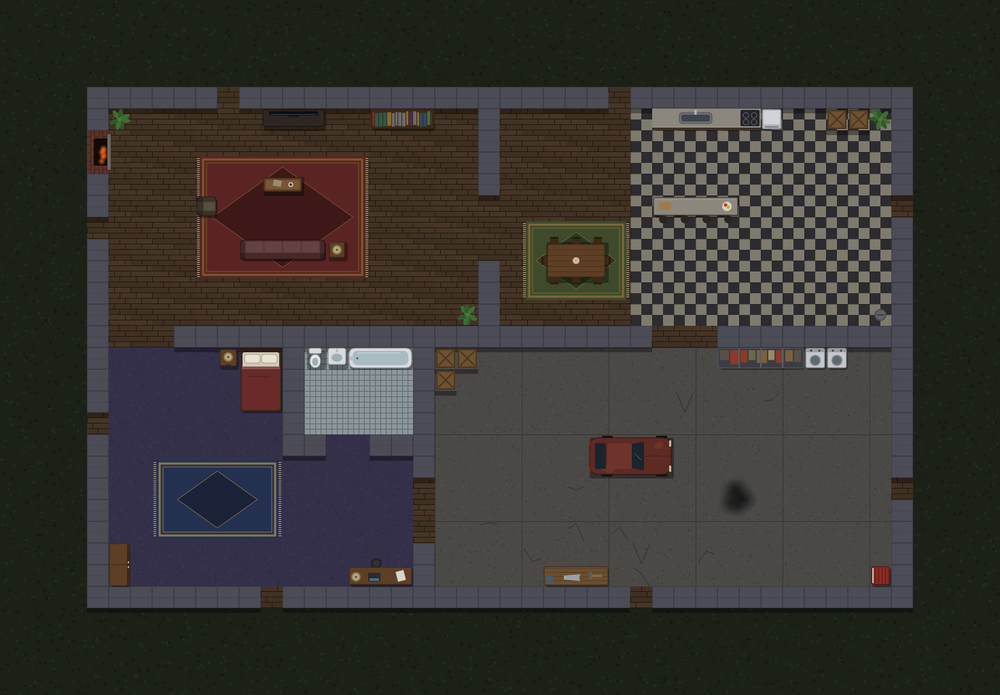
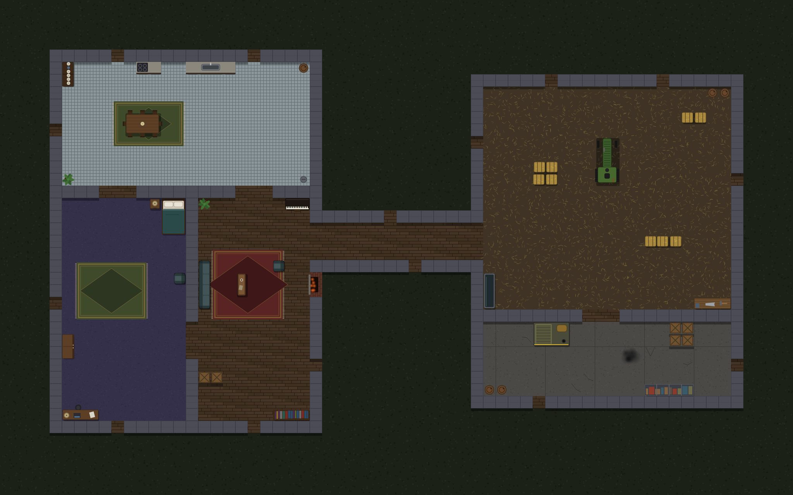

# Top Down Survival

A top-down zombie survival shooter that runs in the browser and on phones. You hold out in a
boarded-up building against rounds of zombies that get tougher each time. They tear the planks off
the windows and climb in, and you shoot them, rebuild the barricades and try to last one more round.

Play alone or with up to three friends in a co-op room.

## The game

Every hit, kill and rebuilt plank earns points. Points buy your way forward: doors that open up more
of the building, guns off the walls, perks, armour, upgrades at the workbench, and a spin of the
mystery box for something better. The buildings start dark, and the box, perks and bench stay dead
until someone finds the power and switches it on.

There are two maps:

- **The House**: a living room, kitchen-diner, bedroom with an en-suite, and a garage with the
  breaker.
- **The Farmstead**: a farmhouse and a barn joined by a covered walkway, with the generator out in
  the barn.




Controls: WASD to move, mouse to aim, click or Space to fire, R to reload, E to interact (hold it to
rebuild a window), F or V to knife, 1/2/Q or the scroll wheel to switch weapons, Esc to pause. On
phones it's twin sticks with buttons for the rest.

All the art is drawn in code and all the sound effects are synthesised, so the only assets in the
repo are the soundtrack files.

## How it fits together

The server runs the game. Every match, solo included, is played in a room on the server, which
simulates the world 60 times a second. Players only send their inputs and draw what the server
sends back, with some prediction so your own movement feels instant.

| Directory | What it is |
|---|---|
| [`client/`](client) | The browser game. TypeScript and the Canvas 2D API, built with Vite, no game framework. |
| [`server/`](server) | Java and Spring Boot with PostgreSQL. `server/sim` is the game simulation itself, plain Java with no Spring in it. `server/app` handles accounts, lobbies, the WebSocket connection, scores, game history and maps. |
| [`mobile/`](mobile) | The iOS and Android apps. They reuse the browser game wholesale, add touch controls and wrap it with Capacitor. See [`mobile/README.md`](mobile/README.md). |
| [`admin/`](admin) | A separate admin site: live rooms and silent spectating, game and player history, map stats, and a map editor. |
| [`maps/`](maps) | The maps, as JSON documents. The server loads them at startup. |
| [`shared/defs/`](shared/defs) | Gameplay numbers (weapons, perks, prices, armour, power-ups) that both the server and the client read. See [`shared/defs/README.md`](shared/defs/README.md). |
| [`docs/`](docs) | Design notes and the map preview images. |

## Running it

The quickest way to get everything up is Docker:

```bash
cp .env.example .env    # set ADMIN_USERNAME and ADMIN_PASSWORD for the first admin login
docker compose up -d --build
```

The game is then on http://localhost:8551 and the admin site on http://localhost:8552.

For working on one part at a time, each client has its own Vite dev server (`npm run dev` in
`client/`, `admin/` or `mobile/`) that talks to a server on port 8080.

## More detail

[`CLAUDE.md`](CLAUDE.md) is the full technical reference: the netcode, the server packages, the
client architecture, how maps work, testing, and the history of how the project got here. The
mobile app has its own [README](mobile/README.md), and [`docs/phase4-coop.md`](docs/phase4-coop.md)
covers the co-op design.
